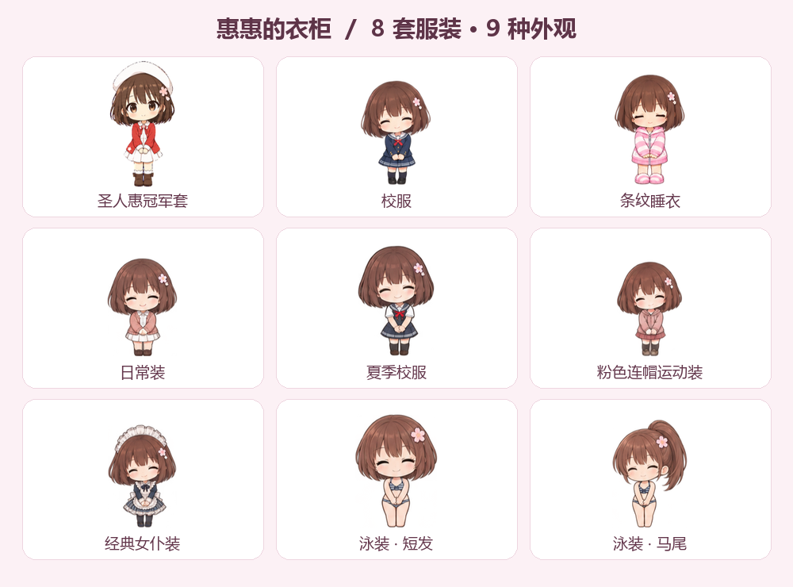
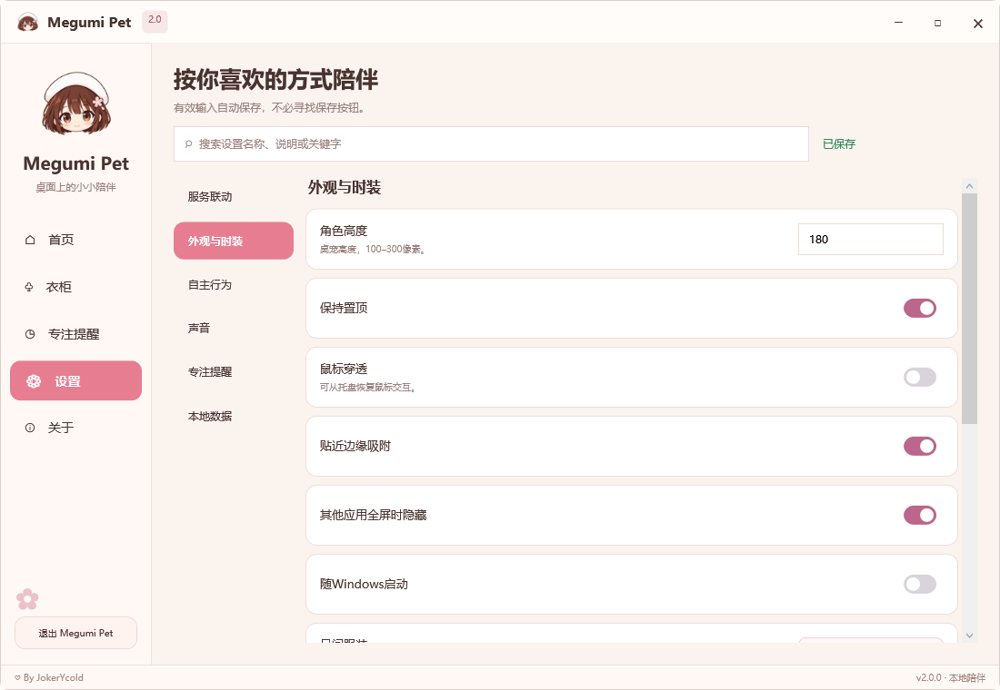

# Megumi Pet · 加藤惠桌宠（Codex + DSH）

> 惠惠有了自己的春日房间。工作时陪你跟随 Codex 或 DeepSeek Harness，闲下来会自己换个姿势、跑动、扒窗和探头。

[下载最新版](https://github.com/JokerYcold/kato-megumi-codex-pet/releases/latest) · [2.0.0 更新公告](https://github.com/JokerYcold/kato-megumi-codex-pet/releases/tag/v2.0.0) · [更新记录](CHANGELOG.md) · [素材与第三方说明](THIRD-PARTY-NOTICES.md)

**Windows x64 · 离线安装版与便携版 · 八套服装 · 九种外观**

## 八套服装，每套都有自己的动作

- 衣柜现有圣人惠冠军套、校服、条纹睡衣、日常装、夏季校服、泳装、连帽运动装和经典女仆装。泳装还能在短发与马尾之间切换。
- 每套支持 **39 个通用动作和 3 个专属动作**。运动装会看手机、整理拉链、侧伸热身，女仆装会端茶、除尘、提裙行礼，泳装有抱泳圈、拍水和披毛巾休息。
- 日常装、夏季校服和两种发型的泳装都重绘了整套动作。跑步补到每方向 8 个姿势，工作时会在思考、打字、记笔记等动作之间轮换。
- 在衣柜可以先看大图、试播完整动作，再点「换上这套」。试播独立于桌面上的任务状态。开启夜间自动睡衣后，到点换上睡衣，白天恢复手选服装。

## 惠惠在桌面上怎么活动

- 启动时，贝雷帽伴着樱花落下，惠惠跳出来接上当前服装的待机动作。演出可跳过、关闭或单独静音。
- 自主活动会在原地小动作、移动、扒窗和侧边探头之间轮换。近处可以跑过去，远处可以飞过去。扒住普通窗口后会跟着窗口移动，窗口最小化或关闭时会松开。
- 散步、远距离飞行、自动扒窗和左右边框探头都有独立开关。扒窗和探头可分别调整节奏与停留范围。
- 桌宠右键菜单、控制中心按钮和下拉选择器统一为樱花粉主题。

## 随手看任务，回原客户端继续聊

| 服务 | 2.0 的联动方式 |
| --- | --- |
| Codex 桌面端 | 跟随任务状态与公开进度。悬浮入口可选本机项目或工作目录，新会话预填草稿后由你在 Codex 确认发送。符合条件时可向所选已有会话排队追问。 |
| DeepSeek Harness（DSH） | 接入随附的只读伴随插件后，可跟随运行、等待审批和完成等状态，显示公开回复。追问可复制草稿并打开客户端。 |
| ChatGPT Windows | 可唤回桌面客户端并交接草稿，由你选择会话、粘贴和发送。 |
| DeepSeek 网页 | 可选试验联动，需要手动配置随附扩展。 |
| 千问、Claude、Kimi | 暂无任务跟随。 |

## 控制中心、专注与提醒

- 五页控制中心集中展示陪伴状态、衣柜、专注提醒、设置和关于。设置可按分类浏览、搜索，合法输入自动保存。
- 专注计时可以暂停、继续和结束，专注与休息时长可调整。喝水、起身和日程提醒可以单独设置，已有日程可编辑。
- 「关于」页可重看版本更新内容，打开项目页、作者 B 站主页和诊断目录，也可以手动检查更新。

## 下载与启动

在 [GitHub Releases](https://github.com/JokerYcold/kato-megumi-codex-pet/releases/latest) 下载 Windows x64 版本。安装版运行 Setup.exe；便携 ZIP 完整解压后运行 HuiHuiPet.exe。两个版本都无需另装 .NET。基础桌宠功能可离线使用。

任务气泡展示对应客户端提供的公开进度和状态。权限审批在原客户端处理。DSH 需要手动接入随附的只读伴随插件。

作者 [JokerYcold](https://space.bilibili.com/198899985)。Megumi Pet 是非官方同人桌宠，供个人非商业使用。