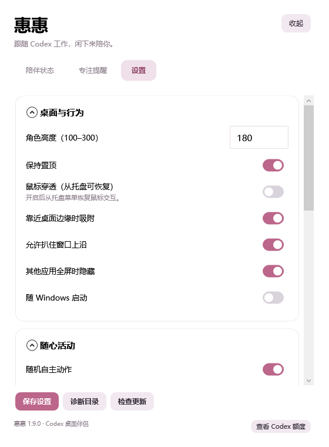

# 加藤惠 Codex 桌宠 · 惠惠

> 跟着 Codex 工作，闲下来就陪你。一个会趴窗、从屏幕两侧探头的 Windows 桌面小伙伴。

[下载最新版](https://github.com/JokerYcold/kato-megumi-codex-pet/releases/latest) · [v1.9.0 发布说明](https://github.com/JokerYcold/kato-megumi-codex-pet/releases/tag/v1.9.0) · [素材与第三方说明](THIRD-PARTY-NOTICES.md)

**Windows x64 · 免安装便携版 · 无需额外安装 .NET · 133 条本地台词**

## 1.9.0 更新 · 更自然的移动与新的设置界面

- 重绘八帧跑步周期，调整步幅同步和身体起伏；保留原素材作为旧版本资源。
- 新增左右滑翔动作。短距离继续走，直线距离超过约三倍角色身高且至少 360 个逻辑像素时可飞行，默认开启，可在设置关闭。
- 飞行使用独立姿势和更快的平滑路径；普通散步、去趴窗与去边框探头都适用。
- 右键操作整理成“快捷开关”和“动作预览”，常用的返回 Codex、趴窗、探头、设置仍方便找到。
- 设置页改为折叠卡片、滑动开关与说明文字，区分触发节奏、自动停留与散步开关，修正版本显示。
- 保留 133 条本地台词、左右探头、自动趴窗及已有 Codex 联动。

### 新版设置界面

### 跑步与滑翔动画

以下是实际资源的逐帧动画预览；桌面上的路径移动和起停由程序控制。

| 跑步循环 | 滑翔循环 |
| --- | --- |
|  |  |

[查看完整更新记录](CHANGELOG.md)

## 她会做些什么？

### 从屏幕两边，偷偷探出头

惠惠会随机选择当前屏幕左侧或右侧，在不同高度走进边框，再侧身探出头。专用动作包含眨眼、微笑与歪头；身体藏在边缘外，过一会儿再出来。

她不会等你很久不操作才活动。你在其他窗口打字、浏览网页时，她也会按自己的随机节奏活动；任务和直接交互优先。

### 找一扇窗，趴一会儿

她会寻找上方有空间、边缘未被其他窗口遮住的普通窗口，先走过去，再把手搭在窗沿上。目标窗口移动或缩放时，她也会跟随。

- 支持随机趴窗，也能拖到窗口上沿或通过右键手动趴住。
- 自动模式随机停留后离开；手动固定不会自动超时。
- 窗口最小化、关闭或不适合继续附着时，会脱离。
- 最大化、贴顶或空间不足时不会强行趴住，可改去屏幕侧边探头。
- 不修改目标窗口的布局，不替你移动其他程序。

### 跟随 Codex，陪你把事情做完

不需要另外开一个桌宠聊天客户端：**双击角色返回 Codex 会话**，工作时在身旁显示状态和公开进度。

| 场景 | 表现 |
| --- | --- |
| Codex 正在工作 | 显示思考、处理、检查修改等状态和对应动作 |
| 有公开进度 | 气泡显示最近的公开说明与结果摘要 |
| 等待确认 | 在记录提供相应事件时显示等待状态；实际审批回 Codex 处理 |
| 任务结束 | 显示结果状态，浮层可见时可展开追问框 |
| 继续追问 | 通过本机 Codex CLI 排队到原会话，避免新开一段独立聊天 |
| 暂时没任务 | 工具条平时隐藏，悬停或编辑时显示；角色可随机活动 |

气泡只展示公开进度和结果摘要，**不展示内部推理全文、工具原始输出或用户原始提示词**。“正在思考”是任务状态标签。

### 133 条台词，不再只说“我只是路过”

本地台词库覆盖日常陪伴、趴窗、探头、散步、挥手、摸头、轻戳、害羞、微笑、点心、伸懒腰、困倦、左右张望和轻微吐槽，共 15 类。

> “嗯？被你发现了。”  
> “借你的窗边待一会儿。”  
> “不用急，一件一件来就好。”

- 根据动作和场景选择，优先避开最近 8 条；小台词池不足时优先避免连续重复。
- 主动说话有随机冷却，不会每次动作都弹一句。
- 可关闭主动台词或轻微吐槽，也可自定义对你的称呼。
- `Assets/dialogue.zh-CN.json` 可自行编辑，保存后重启生效。
- 台词是本地文字气泡，不调用模型、不消耗 Codex 额度，也不包含语音朗读。

### 其他陪伴功能

| 功能 | 说明 |
| --- | --- |
| 桌面角色 | 透明背景、无边框、置顶，支持拖动与位置记忆 |
| 外观 | 默认高 180px，可调 100–300px，带樱花发饰及短时庆祝效果 |
| 随机活动 | 待机小动作、整屏散步、趴窗、左右探头分别可开关 |
| 行走 | 当前显示器工作区内随机路径，平滑起停；不要求用户闲置 |
| 专注计时 | 默认 25 分钟专注、5 分钟休息，可自定义 |
| 提醒 | 日程、喝水和久坐提醒，支持暂停与时间段设置 |
| 托盘 | 显示、隐藏、设置、恢复鼠标交互和退出 |
| 工作习惯 | 鼠标穿透、贴边、开机启动、全屏隐藏及音量设置 |

## 下载与启动

1. 打开 [Releases](https://github.com/JokerYcold/kato-megumi-codex-pet/releases/latest)。
2. 下载 `HuiHuiPet-v1.9.0-win-x64-portable.zip`，**完整解压**。
3. 运行解压目录中的 `HuiHuiPet.exe`。请保留旁边的 DLL 和 Assets 文件夹。
4. 右键惠惠或托盘图标，进入设置。

当前提供 Windows x64 自包含包，不需要安装 .NET、Python 或其他开发工具。没有 macOS、Linux 或 ARM64 专用包。附件中提供 SHA256 校验文件；程序目前未做代码签名。

**升级：**先从托盘退出旧版，再解压到新目录运行。设置与提醒保存在当前用户的本地数据目录，不在便携程序目录中。请勿同时运行多个版本。

## 基本操作

| 操作 | 用途 |
| --- | --- |
| 单击角色 | 随机互动与台词回应 |
| 按住左键拖动 | 移动角色，脱离趴窗或探头状态 |
| 双击角色 | 返回当前跟随的 Codex 会话；无可用目标时打开新会话入口 |
| 鼠标悬停角色或浮层 | 显示悬浮工具条，移开后延迟收起 |
| 右键角色 | 趴窗、探头、动画、设置、专注提醒和退出 |
| 托盘菜单 | 隐藏后唤回；鼠标穿透开启时恢复交互 |
| 追问框 Ctrl+Enter | 将追问排队至原会话；普通 Enter 换行 |

## 活动频率怎么设置？

| 设置 | 作用 | 想要活泼一点时 |
| --- | --- | --- |
| 自己随机趴窗 | 自动寻找窗口并趴住 | 开启 |
| 趴窗节奏基准 | 控制趴窗机会的频繁程度 | 15 秒 |
| 自己随机从左右边框探头 | 开启自主侧边探头 | 开启 |
| 探头节奏基准 | 控制探头机会的频繁程度 | 20 秒 |
| 平均活动间隔 | 普通随机小动作与散步的节奏 | 12 秒 |

基准越小越活跃，**不表示严格每隔这么多秒执行**。程序会随机改变活跃程度、触发间隔、目标和停留时间。任务、交互、走路与停留期间会延后下一次活动。

自动趴窗与探头当前每次停留 **8–25 秒**，鼠标操作宠物或浮层时可延后离开；目前没有停留时长设置。手动趴窗不会自动超时。关闭普通散步不影响走去趴窗或探头；若希望完全停止自主移动，请同时关闭散步、自动趴窗和自动探头。

## 一定要安装 Codex 吗？

**不一定。**动画、散步、趴窗、探头、台词、专注和提醒可以独立使用。

| Codex 功能 | 条件 |
| --- | --- |
| 自动跟随任务与公开进度 | 本机有可读取的 Codex 桌面端会话记录 |
| 双击回到会话 | 已安装能处理会话链接的 Codex 桌面端 |
| 悬浮追问 | 本机已安装、已登录且支持 `queue` 命令的 Codex CLI |
| 自动检测失败 | 在设置指定会话记录目录或 `codex.exe` 路径 |

默认读取当前用户 `.codex/sessions`；配置了 `CODEX_HOME` 时读取该目录下的 `sessions`。桌宠不会附带发布者的账号，也不会登录别人的 Codex；实际任务使用你自己的账号和额度。

这是一款独立陪伴应用，不是 Codex 官方内置 Pets 插件。它读取本机会话记录来跟随状态，**不是官方实时事件订阅**。Codex 版本、日志格式、远程任务、异常退出等情况可能影响识别，不能保证所有版本即装即用。权限审批、取消任务和完整结果查看仍在 Codex 中完成。

“已排队”只表示 CLI 接受请求，不代表桌面端已经执行。界面还会等待会话记录确认；未确认时保留文本，不自动重复发送，并提供回到原会话检查的入口。

## 隐私与本地数据

- 发布包不含个人设置、账号凭据、真实会话、诊断日志或旧版备份。
- 不读取或保存 Codex 登录凭据；通过已登录的本机 CLI 执行需要的操作。
- 公开进度和追问草稿只保留在桌宠运行内存中；退出后不由桌宠保存。发送后的会话由 Codex 自身管理。
- 设置、提醒和专注记录位于 `%LOCALAPPDATA%/HuiHuiPet`；历史默认保留 30 天，可调整。
- 没有遥测，也没有自动下载或静默安装更新。开机启动需手动开启。
- 仓库配图为程序离线渲染的示例场景，不是个人桌面或真实会话截图。

## 当前范围与常见问题

**她为什么不趴最大化窗口？** 窗口上方没有足够的头部空间时不会强行趴住，可以去屏幕两边探头。带标题栏的普通最大化窗口与真正全屏应用分别处理。

**她为什么突然不见了？** 检查“其他应用全屏时隐藏”、托盘隐藏和鼠标穿透设置，可从托盘唤回。

**她为什么不主动说话？** 开启“允许主动说一句话”。主动台词带随机冷却，Codex 正在工作时不会主动插话；点击互动仍可回应。

**活动范围包含其他显示器吗？** 自主行走覆盖当前显示器工作区，不提供跨屏寻路或窗口避障。混合 DPI 跨屏、不同应用边框及各类游戏全屏仍需实际环境验收。

**动画是否每个都完全重新绘制？** 当前有 33 个动画条目，部分动作复用已有关键帧；新增趴窗和侧身探头为适配动作，不等同于 33 套独立高帧率重绘。

本版已通过 22 项核心自动测试与离线 WPF 渲染自检；趴窗跟随与左右探头通过自建原生测试窗口验证。测试通过不等于所有电脑、Codex 版本或游戏均已实测。

## 项目与素材声明

个人非官方角色陪伴项目，与 OpenAI、《路人女主的养成方法》及其权利方无关联。加藤惠的角色名称、设定及相关权利归原权利方所有。

项目包含原有角色素材及 AI 生成的衍生动作，**尚未取得原角色的商业或公开分发授权；非商业声明不等同于授权**。请勿将本项目作为已获角色授权的商品出售。详见 [素材与第三方说明](THIRD-PARTY-NOTICES.md)。

当前仓库提供使用介绍、示例配图和便携版 Release，尚未发布应用源码或授予开源许可。
